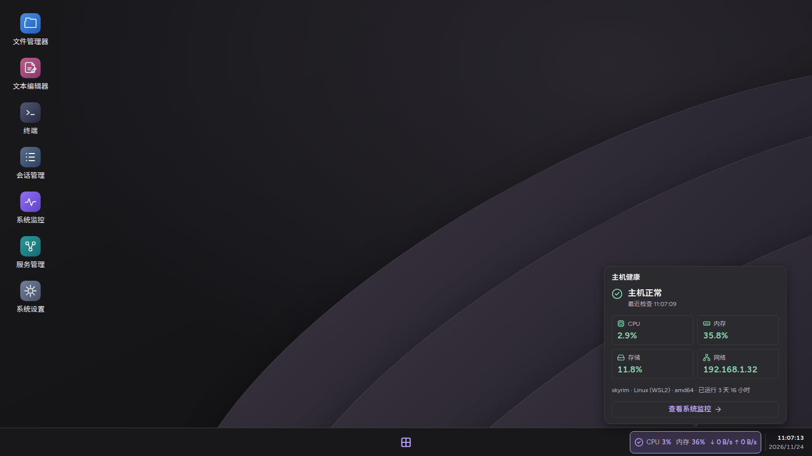

# goDesk

goDesk 是面向单台 Linux 主机和一位操作者的 Web 桌面项目。当前版本提供桌面前端、操作者认证、主机文件管理、文本编辑、终端、系统监控、主机健康状态中心和服务管理。


| 深色桌面的开始菜单 | 深色主题下的多窗口布局 |
| --- | --- |
|  |  |

## 当前功能

- 首次访问时创建操作者密码。登录会话持续 7 天，关闭浏览器或重启服务后可继续使用有效会话。
- 文件管理器和文本编辑器可在管理员模式下操作 Linux 主机，终端沿用运行账号。终端支持多窗口和后台会话，关闭窗口后可重新接回。系统监控显示 CPU、内存、磁盘、网卡和端口占用；底栏主机健康入口显示整体健康状态和异常数量，点击可查看原因、阈值和维度摘要；服务管理在 systemd 主机上提供列表、启停、开机自启和日志；主机设置仍使用示例逻辑，后续实现范围见 [首版规格](.scratch/backend-v1/spec.md)。
- 发布构建将前端资源嵌入 Go 二进制，由同一个进程提供桌面、认证、文件、终端、系统监控、服务管理和 `/healthz` 存活检查接口。

## 项目结构

- `frontend/` 包含 React、TypeScript 和 Vite 前端，源自 [React Web Desktop 脚手架](https://github.com/EziosWJ/react-web-desktop)。
- `backend/` 包含 Go 模块、HTTP 服务、SQLite 连接和前端资源嵌入代码。
- `docs/adr/` 保存项目的 [架构决策记录](docs/adr/)。

## 本地开发

开发和完整构建使用 Linux、Go 1.26、Node.js 24、pnpm 12 和 GNU Make。从项目根目录运行以下命令。

```sh
git clone https://github.com/EziosWJ/GoDesk.git
cd GoDesk
pnpm --dir frontend install --frozen-lockfile
make dev
```

打开 Vite 输出的地址，默认是 `http://localhost:5173`。Vite 将 `/api` 请求转发到 `127.0.0.1:5000`，Go 服务的健康检查可用 `curl -fsS http://localhost:5000/healthz` 验证，正常时返回 `{"status":"ok"}`。按 Ctrl+C 停止两个服务。联调使用项目根目录的 `data/godesk.db`。

也可以在两个终端中分别启动前端和后端。

```sh
pnpm --dir frontend dev
go -C backend run ./cmd/godesk -data-dir ../data
```

提交前可运行以下检查。

```sh
pnpm --dir frontend lint
go -C backend test ./...
```

## 下载

从 [Releases](https://github.com/EziosWJ/GoDesk/releases) 下载对应 Linux 架构的压缩包（`386`、`amd64`、`arm64`、`armv7`），解压后运行其中的 `godesk`。同一 Release 提供 `SHA256SUMS` 用于校验。

## 构建与运行

```sh
make build
./godesk -listen 127.0.0.1:5000 -data-dir ./data
```

在浏览器访问 `http://localhost:5000`，按提示创建密码并进入桌面。发布目标机只需与其平台匹配的 `godesk` 二进制。程序会创建数据目录和 SQLite 文件。

| 命令或选项 | 用途 |
| --- | --- |
| `make build` | 构建并嵌入静态资源，生成 `./godesk`。 |
| `make build-backend` | 生成纯后端二进制，提供认证、文件管理、终端、系统监控、主机健康状态、服务管理和健康检查接口。 |
| `make help` | 列出构建和开发命令。 |
| `OUTPUT` | 覆盖二进制路径，例如 `make build OUTPUT=/tmp/godesk`。 |
| `FRONTEND_DIR` | 覆盖用于开发和构建的前端源码目录，默认为 `frontend`。 |
| `-listen` | 设置 HTTP 监听地址，默认为 `0.0.0.0:5000`。 |
| `-data-dir` | 设置持久化目录，默认为启动时工作目录下的 `./data`。 |
| `-service-backend` | 设置服务管理后端，`auto`（默认）、`systemd` 或 `none`。 |
| `-extension-grants` | 设置插件服务授权 JSON 文件，按插件 ID 授予已有 systemd 服务的查询和重启权限。 |

## 主机权限

通常用日常账号启动 goDesk。需要免密管理主机时，由该账号在主机终端运行以下命令。安装规则后，任意使用该 Linux 账号的进程都能免密运行 root 命令。

```sh
sudo ./godesk --setup-sudo
./godesk --check-sudo
```

撤销 GoDesk 托管规则时执行 `sudo ./godesk --remove-sudo`。启用免密 sudo 或以 root 运行时，goDesk 是主机管理员入口，请在受信任的访问环境中完成首次初始化。各命令与权限范围详见[主机权限契约](docs/privileges.md)。

## 修改与重置密码

登录后，在「系统设置 → 账户」输入当前密码和两遍新密码。修改成功后当前浏览器继续登录，其他设备需重新登录。

忘记密码时，先停止服务，再在主机终端运行以下命令。将 `-data-dir` 指向服务原来使用的数据目录，按提示隐藏输入两遍新密码。重启服务后使用新密码登录。

```sh
./godesk reset-password -data-dir ./data
```

## 终端

从桌面或开始菜单启动「终端」可打开新的 Shell。「会话管理」是独立应用，可打开已有会话或取得控制权。多个窗口可以同时查看同一个 Shell，其中一个窗口可以输入和调整终端尺寸。关闭窗口、浏览器或退出登录后，仍可接回正在运行的 Shell。停止或重启 goDesk 会结束所有终端会话。回看行数在「系统设置 → 终端」中调整，默认为 5,000 行。

## 服务管理

从桌面或开始菜单打开「服务管理」。首版支持 systemd 主机：列出 system 级服务，显示运行状态和开机自启状态，可以启动、停止、重启、启用/禁用开机自启，并查看最近的 journal 日志。探测顺序和 `-service-backend` 参数见[服务管理文档](docs/services.md)。

system 级服务的写操作可使用免密 sudo，也可沿用运行账号的 polkit 授权。列表和 journal 日志使用运行账号的读取权限，权限不足时界面会显示明确错误。

## 扩展插件

从开始菜单打开「扩展」应用，插件在该应用内安装和启用。插件包格式、生命周期与 Host API 见[扩展宿主契约](docs/extensions.md)。

插件默认不能访问系统服务。需要让插件查询或重启已有 systemd 服务时，启动时通过 `-extension-grants` 指定授权 JSON 文件；文件按插件 ID 配置允许的服务单元、动作以及是否通过非交互 sudo 执行，格式见 [Extension-Host 服务授权与 `host.services`](https://github.com/EziosWJ/Extension-Host#服务授权与-hostservices)。授权按插件 ID 生效，未授权、单元缺失和 systemd 不可用时调用会报告对应原因。

## 主机健康状态中心

底栏右侧显示被管理主机的整体健康状态（正常、警告、严重或未知）和异常数量。点击入口打开健康面板，可以查看异常原因、当前值、生效阈值、异常开始时间、CPU/内存/存储/网络维度摘要和主机信息，并跳转到系统监控查看详细指标。

健康状态由后端消费系统监控的同一份指标快照计算，底栏每 5 秒轮询；GoDesk 连接中断与主机健康状态分开表达。阈值、持续判定和恢复规则见[主机健康状态中心 Spec](docs/specs/host-health-center.md)，接口契约见[系统监控与主机健康](docs/system-monitoring.md#主机健康状态接口)。



## 相关文档

- [GoDesk Extension Host 首版契约](docs/extensions.md)
- [GoDesk Extension Host 实施 Spec](.scratch/extension-host/spec.md)
- [认证行为与 HTTP 接口](docs/authentication.md)
- [主机权限、sudo 命令与监听端口契约](docs/privileges.md)
- [文件管理与文本编辑契约](docs/file-management.md)
- [系统监控与主机健康 API 契约](docs/system-monitoring.md)
- [主机健康状态中心 Spec（Host Health Center）](docs/specs/host-health-center.md)
- [终端会话及接口契约](docs/terminal.md)
- [服务管理行为与 HTTP 接口](docs/services.md)
- [前端使用与开发说明](frontend/README.md)
- [UI 设计规范](frontend/docs/ui-design/01-design-principles.md)
- [项目术语](GLOSSARY.md)
