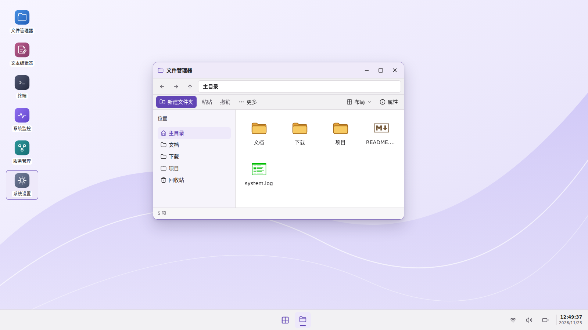

# goDesk

goDesk 是面向单台 Linux 主机和一位操作者的 Web 桌面项目。当前版本提供可体验的桌面前端，以及带 SQLite 就绪检查的 Go 服务。



## 当前功能

- 前端提供多窗口桌面、文件管理器、文本编辑器、终端、系统监控、服务管理和设置。演示密码为 `react-web-desktop`，登录和应用数据由浏览器内的演示逻辑处理。
- 后端启动时连接 SQLite，提供 `GET /healthz`。主机登录、文件操作、终端和监控接口的后续实现范围见 [首版规格](.scratch/backend-v1/spec.md)。
- 发布构建将前端资源嵌入 Go 二进制，由同一个进程提供桌面页面和健康检查。

## 项目结构

- `frontend/` 包含 React、TypeScript 和 Vite 前端，源自 [React Web Desktop 脚手架](https://github.com/EziosWJ/react-web-desktop)。
- `backend/` 包含 Go 模块、HTTP 服务、SQLite 连接和前端资源嵌入代码。
- `docs/adr/` 保存项目的 [架构决策记录](docs/adr/)。

## 本地开发

开发和完整构建使用 Linux、Go 1.26、Node.js 24、pnpm 12 和 GNU Make。从项目根目录运行以下命令。

```sh
git clone https://github.com/EziosWJ/GoDesk.git
cd GoDesk
pnpm --dir frontend install --frozen-lockfile
make dev
```

打开 Vite 输出的地址，默认是 `http://localhost:5173`。Go 服务监听 `8080` 端口，健康检查可用 `curl -fsS http://localhost:8080/healthz` 验证，正常时返回 `{"status":"ok"}`。按 Ctrl+C 停止两个服务。联调使用项目根目录的 `data/godesk.db`。

也可以在两个终端中分别启动前端和后端。

```sh
pnpm --dir frontend dev
go -C backend run ./cmd/godesk -data-dir ../data
```

提交前可运行以下检查。

```sh
pnpm --dir frontend lint
go -C backend test ./...
```

## 构建与运行

```sh
make build
./godesk -listen 127.0.0.1:8080 -data-dir ./data
```

在浏览器访问 `http://localhost:8080` 即可打开桌面。发布目标机只需与其平台匹配的 `godesk` 二进制。程序会创建数据目录和 SQLite 文件。

| 命令或选项 | 用途 |
| --- | --- |
| `make build` | 构建并嵌入静态资源，生成 `./godesk`。 |
| `make build-backend` | 生成纯后端二进制，仅提供健康检查。 |
| `make help` | 列出构建和开发命令。 |
| `OUTPUT` | 覆盖二进制路径，例如 `make build OUTPUT=/tmp/godesk`。 |
| `FRONTEND_DIR` | 覆盖用于开发和构建的前端源码目录，默认为 `frontend`。 |
| `-listen` | 设置 HTTP 监听地址，默认为 `0.0.0.0:8080`。 |
| `-data-dir` | 设置持久化目录，默认为启动时工作目录下的 `./data`。 |

## 相关文档

- [前端使用与开发说明](frontend/README.md)
- [UI 设计规范](frontend/docs/ui-design/01-design-principles.md)
- [项目术语](GLOSSARY.md)
