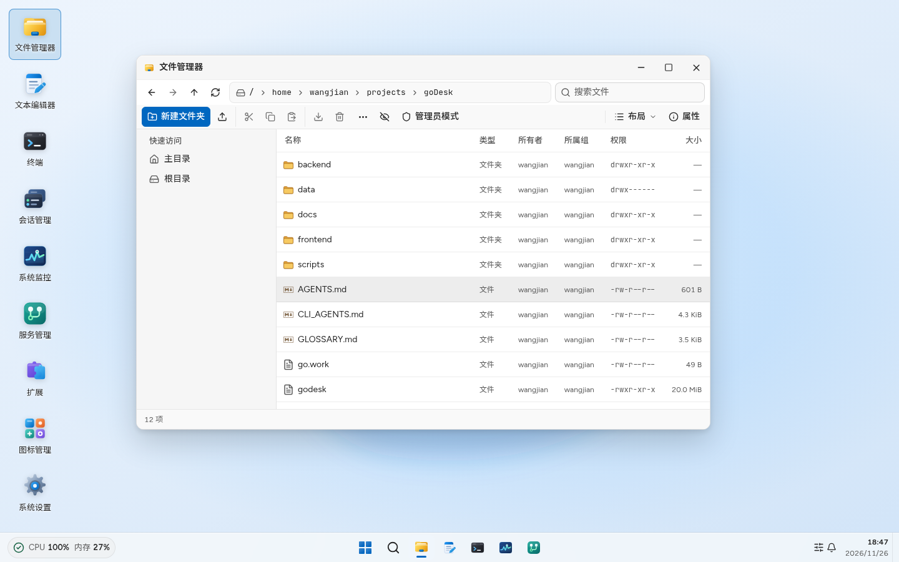
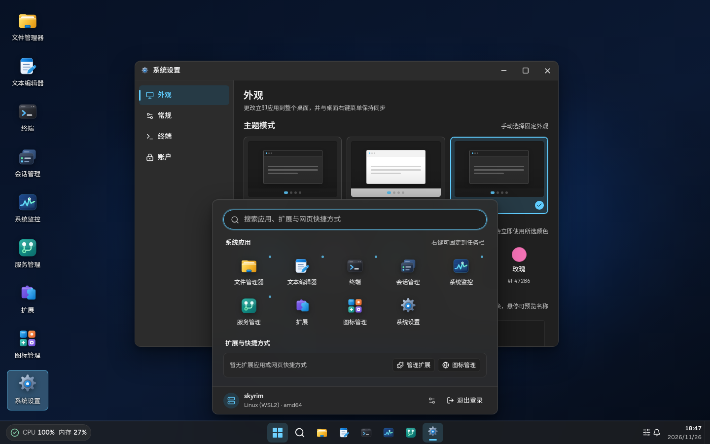
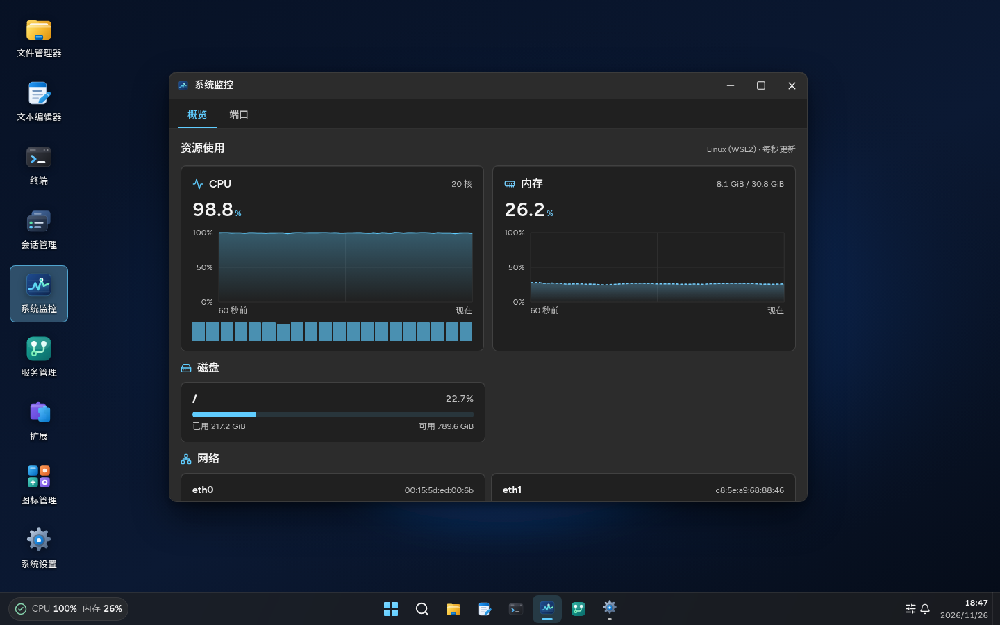
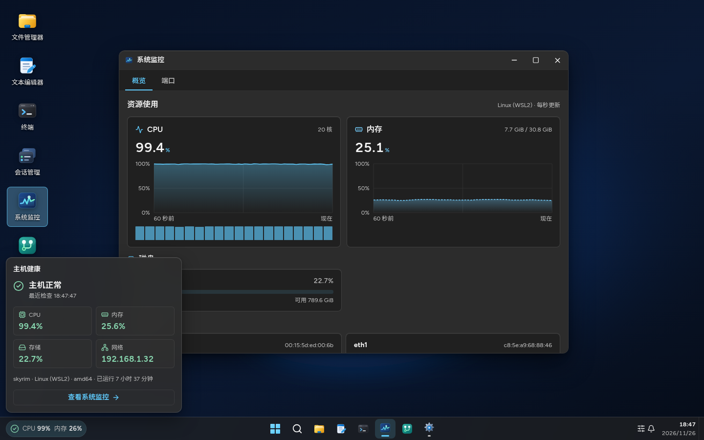

<div align="center">
  
  <h1>goDesk</h1>
  <p><strong>在浏览器里，管理你的 Linux 主机。</strong></p>
  <p>一个面向单台 Linux 主机的自托管 Web 桌面。</p>
  <p>
    <a href="https://github.com/EziosWJ/GoDesk/releases/tag/v0.1"></a>
    <a href="LICENSE"></a>
    <a href="https://github.com/EziosWJ/GoDesk/releases"></a>
  </p>
  <p><a href="README.md">English</a> · 简体中文</p>
</div>



goDesk 将文件、终端、系统监控和服务管理带进浏览器桌面，面向一位操作者管理一台 Linux 主机的场景。Go 服务内嵌前端资源，发布版本只需运行一个二进制文件。

## 功能

- **桌面工作区**：多窗口、应用搜索、外观自定义，以及窗口磁吸与贴边分屏。
- **文件与编辑**：通过图形界面浏览、上传、下载、移动和编辑主机文件。
- **终端会话**：在浏览器运行 Shell，关闭窗口或浏览器后仍可接回会话。
- **系统监控**：查看 CPU、内存、存储、网络和端口，并从任务栏了解主机健康状态。
- **服务管理**：在支持的主机上查看和管理 systemd 服务及日志。
- **扩展插件**：在桌面中安装和启用插件，并按需配置服务访问权限。

| 开始菜单 | 系统监控 |
| --- | --- |
|  |  |



## 快速开始

1. 从 [Releases](https://github.com/EziosWJ/GoDesk/releases) 下载与 Linux 架构匹配的压缩包（`386`、`amd64`、`arm64` 或 `armv7`）。同一 Release 提供 `SHA256SUMS` 用于校验。
2. 解压并启动（以下以 `amd64` 为例）：

   ```sh
   tar -xzf godesk_*_linux_amd64.tar.gz
   ./godesk -listen 127.0.0.1:5000 -data-dir ./data
   ```

3. 打开 [http://localhost:5000](http://localhost:5000)，按提示创建操作者密码。goDesk 会在数据目录中创建 SQLite 数据库。

示例只监听本机；默认监听地址为 `0.0.0.0:5000`，可用 `-listen` 按环境调整。访问和权限范围详见[主机权限文档](docs/privileges.md)。

### 主机权限

通常使用日常 Linux 账号运行 goDesk。启动和登录后，如需免密管理员访问，打开「终端」，点击底部状态栏的盾牌图标「配置免密 sudo（可选）」，复制命令到终端执行。运行账号须已有 sudo 授权。也可以在二进制所在目录的主机 Shell 中执行：

```sh
sudo ./godesk --setup-sudo
./godesk --check-sudo
```

配置后，**任何使用该 Linux 账号运行的进程**都可以免密执行 root 命令。启用免密 sudo 或以 root 运行时，请将 goDesk 视为主机管理员入口，并在受信任的环境中完成首次初始化。权限范围和撤销方法见[主机权限文档](docs/privileges.md)。

## 构建与开发

开发和完整构建需要 Linux、Go 1.26、Node.js 24、pnpm 12 和 GNU Make。

```sh
git clone https://github.com/EziosWJ/GoDesk.git
cd GoDesk
pnpm --dir frontend install --frozen-lockfile
make dev
```

打开 Vite 输出的地址，默认为 `http://localhost:5173`。开发服务器将 API 请求转发到 5000 端口的 Go 后端。构建单文件程序及运行检查：

```sh
make build
pnpm --dir frontend lint
go -C backend test ./...
```

需要联调 Extension Host 源码时，请参阅[扩展文档](docs/extensions.md#从源码联调-godesk)。

## 文档

- [前端开发](frontend/README.md) · [UI 设计规范](frontend/docs/ui-design/01-design-principles.md)
- [认证](docs/authentication.md) · [主机权限](docs/privileges.md)
- [文件管理与文本编辑](docs/file-management.md) · [终端会话](docs/terminal.md)
- [系统监控与主机健康](docs/system-monitoring.md) · [服务管理](docs/services.md)
- [扩展与 Host API](docs/extensions.md) · [架构决策](docs/adr/)

## 参与贡献

欢迎通过 [GitHub Issues](https://github.com/EziosWJ/GoDesk/issues) 反馈问题和提出建议。参与开发时，请参考上方的开发说明并运行相关检查。

## 致谢

感谢所有让 goDesk 成为可能的开源项目及其贡献者，包括 [React Web Desktop](https://github.com/EziosWJ/react-web-desktop)、[React](https://react.dev/)、[WMKit](https://github.com/Surdeddd/wmkit)、[xterm.js](https://xtermjs.org/)、[Monaco Editor](https://microsoft.github.io/monaco-editor/)、[Extension Host](https://github.com/EziosWJ/Extension-Host)、[SQLite](https://sqlite.org/) 和 [gopsutil](https://github.com/shirou/gopsutil)，以及其他所有直接和间接依赖。

## 许可证

[Apache License 2.0](LICENSE)。
