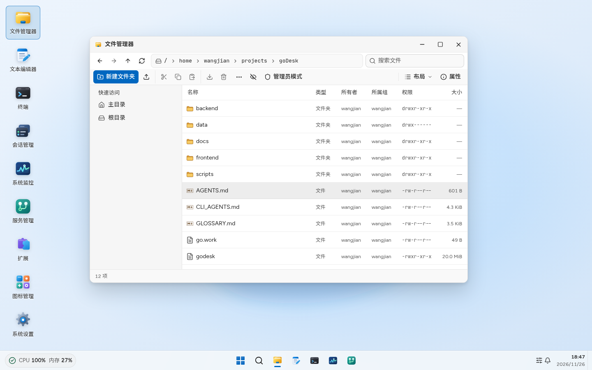
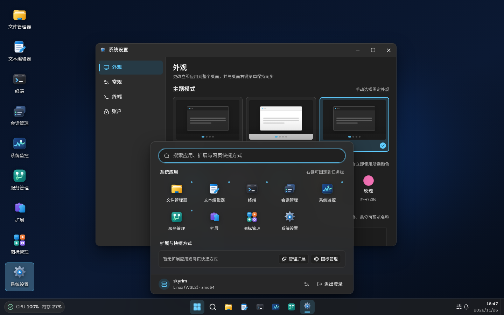
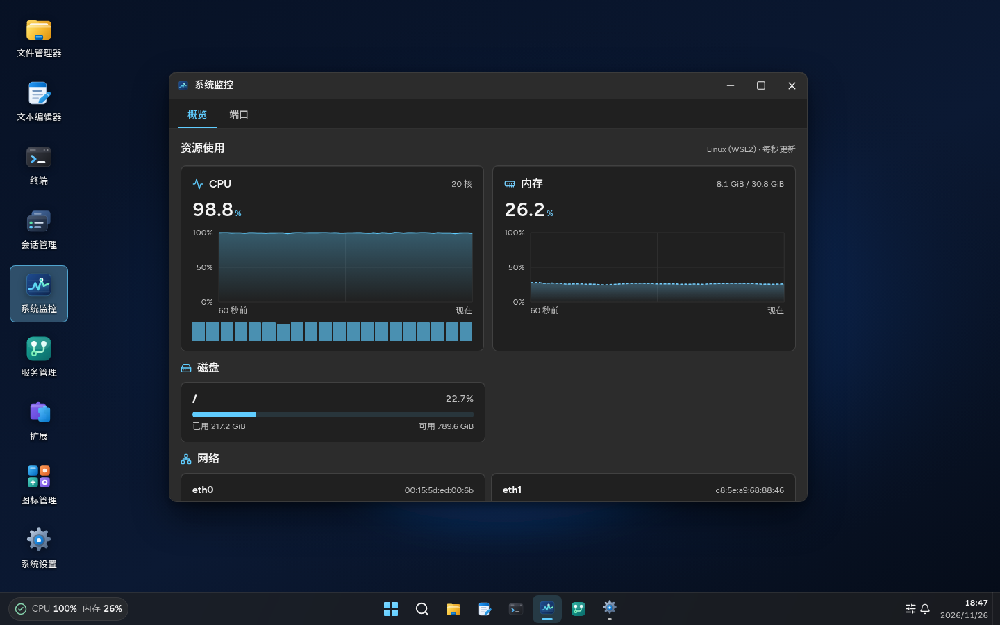
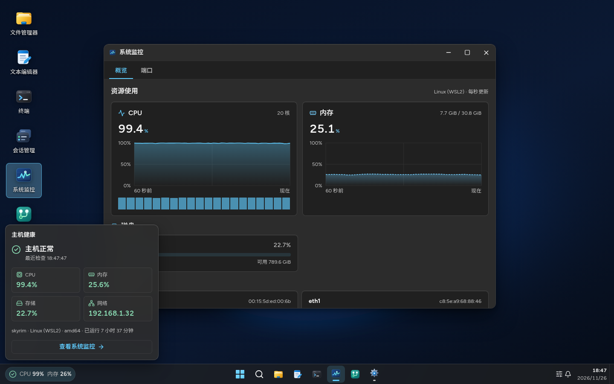

# React Web Desktop

goDesk 的 `frontend/` 基于 React Web Desktop 脚手架，使用 React、TypeScript、Vite、Tailwind CSS 4 和 WMKit。桌面入口通过 Go 服务完成认证。完整项目的联调和发布步骤见 [goDesk 项目说明](../README.md)。

桌面外壳包含桌面快捷方式、开始菜单、任务栏和右键菜单。应用可以在可拖动、缩放、最小化和最大化的窗口中打开。内置文件管理器、文本编辑器、终端、系统监控、服务管理和系统设置，可作为接入自有应用的参考。

## 界面预览



| 深色桌面的开始菜单 | 深色主题下的多窗口布局 |
| --- | --- |
|  |  |



## 快速开始

在 `frontend/` 目录使用 Node.js 24 和 pnpm 12 运行以下命令。

```sh
pnpm install --frozen-lockfile
pnpm dev
```

同时启动监听 `5000` 端口的 Go 服务，再在浏览器打开 Vite 输出的地址，默认是 `http://localhost:5173`。首次访问按提示创建密码。

在本地地址后加上 `?window-theme=glass` 可预览 WMKit Glass 窗口外观。

## 基于脚手架开发

1. 在 `src/` 创建应用组件，并参照 `src/apps.ts` 中的 `monitor` 条目注册应用 ID、名称、图标、窗口默认尺寸和 `Content` 组件。桌面快捷方式和开始菜单会自动列出新应用，启动后可在任务栏切换。
2. 在 `src/styles/theme.css` 统一调整颜色、字体和尺寸。新增界面可复用 `--godesk-*` CSS 变量及其 Tailwind 映射。布局和交互细节见 [UI 设计规范](docs/ui-design/01-design-principles.md) 和 [设计 Token](docs/ui-design/02-design-tokens.md)。
3. 定制品牌时，修改 `package.json` 中的包名、`index.html` 的页面标题、`public/favicon.svg` 的标识，以及登录页和桌面外壳中的显示名称。
4. `src/Session.tsx` 根据后端会话状态显示初始化页、登录页或桌面。文件管理器、文本编辑器、终端、系统监控和服务管理连接 Linux 主机，数据与操作来自后端。

## 构建与部署

在 `frontend/` 目录运行以下命令。

```sh
pnpm lint
pnpm build
pnpm preview
```

`pnpm build` 先运行 TypeScript 检查，再生成 `dist/` 静态产物。预览时需要运行 Go 服务。项目发布使用根目录的 `make build`，将静态资源与 Go 服务打包为同一个二进制。

## 体验内置应用

- 通过「开始 → 退出登录」清除当前浏览器的登录 Cookie，并重置桌面和未保存的草稿。在「系统设置 → 账户」可以修改密码。
- 单击桌面快捷方式选中，双击打开。也可以用 Tab 聚焦后按 Enter 打开，或在开始菜单中搜索并启动。
- 拖住窗口标题栏可移动窗口，拖动边缘和四角可改变尺寸。标题栏按钮支持最小化、最大化、还原和关闭。
- 任务栏显示已打开的窗口和当前焦点。点击任务栏项可激活对应窗口或从最小化恢复。
- 在「系统设置 → 外观」切换主题。外观适用于桌面外壳与全部内置应用。
- 在桌面空白处右键，可选择暮紫或灰阶壁纸。取消勾选当前选项可恢复默认鸢尾壁纸。选择「刷新」可以重新加载桌面。

### 文件管理器

- 默认打开 goDesk 运行账号的主目录。可以从「位置」打开主目录或根目录，点击路径旁的铅笔输入绝对路径，也可以用面包屑和历史按钮切换目录。点「刷新」读取主机上的变化。
- 可在列表、平铺、大图标间切换，在当前目录按名称筛选或显示隐藏文件。浏览器会记住视图和最后一次手动调整的普通窗口尺寸。窄窗口可从「位置」「属性」和「更多」访问相应功能。
- 单击选择文件，按 Ctrl（macOS 用 Command）切换多选，按 Shift 连续选择。双击或按 Enter 打开文件夹、图片预览或文本编辑器。右键或按 Shift+F10 可选择「预览」或「下载」。
- 「新建文件夹」创建目录，F2 原位重命名，Ctrl+X/C/V 在应用内剪切、复制和粘贴。可以从「更多」选择目标目录，也可以将条目拖到文件夹或侧栏位置。
- 可通过「上传文件」选择多个本地文件，也可直接拖进文件管理器，松开即上传到当前目录。选中一个普通文件可下载。上传、复制和移动遇到同名项时，可以保留两者或跳过。按 Delete 后确认永久删除，逐项结果可从状态栏查看。

### 文本编辑器

- 从桌面、开始菜单或文件管理器打开。支持编辑无 NUL 字节且不超过 5 MiB 的 UTF-8 文件，包含无后缀文件和 `.conf`。在同一身份下重开同一路径会切换到已有编辑标签页。只读预览在单独的标签页展示。
- 点击「保存」或按 Ctrl+S（macOS 用 Command+S）写回文件。首次保存或另存为时填写名称并选择目录，文件名按输入保存。关闭含有修改的标签页或窗口时，可以保存、放弃修改或取消关闭。
- 在 goDesk 中改名或移动后，标签页会跟随新路径。源文件在外部被修改、移动或删除后，保存时会保留草稿，可另存为新文件。

更多操作细节和 HTTP 接口见 [文件管理契约](../docs/file-management.md)。

### 终端和系统监控

- 终端使用 xterm.js 连接 Linux 主机 Shell。每个新建会话打开独立窗口，可从「会话管理」改名、接回、接管或结束。关闭窗口后 Shell 继续运行。回看行数可在「系统设置 → 终端」中修改。 [终端会话及接口契约](../docs/terminal.md)
- 系统监控显示 CPU、内存、磁盘用量、网卡地址与收发速率，以及 TCP/UDP 端口占用。概览每秒刷新，端口页每 5 秒刷新，数据来自后端真实采集。[系统监控契约](../docs/system-monitoring.md)

## 技术实现

- React 和 TypeScript 渲染桌面、菜单、任务栏、窗口外观和内置应用。项目使用 Tailwind CSS 4、Lucide React 和少量专用 CSS。
- `src/styles/theme.css` 定义语义颜色和共用尺寸，并通过 Tailwind CSS 4 的 `@theme inline` 暴露。页面首次绘制前解析外观，运行中统一更新根节点的 `data-theme` 和 CSS `color-scheme`。Monaco 与 xterm.js 读取同一套颜色变量。
- `src/App.tsx` 通过 WMKit 0.13.1 的官方 React Adapter 绑定工作区和窗口。WMKit 处理指针交互、窗口生命周期、焦点和层级，任务栏从同一个 WMKit 状态读取窗口和焦点。
- 工作区预留任务栏高度。WMKit 根据工作区调整最大化窗口，限制普通浮动窗口的最小尺寸为 320 × 240 CSS 像素，并保留可抓取的标题栏区域。
- `src/apps.ts` 定义应用快捷方式和窗口初始尺寸。文本编辑器的标签页和文件操作在 `src/TextEditorApp.tsx`，可复用的文本编辑接口在 `src/text-editor/index.tsx`。替换引擎时在该入口选择新的适配器并重新构建。Monaco 适配器和本地 Worker 在首次打开文档时按需载入，同一网页中的 Monaco 实例共享主题。

## 浏览器状态

刷新会重置打开的窗口、桌面壁纸和未保存的草稿。运行中的终端会话可以从会话管理接回。主题、窗口尺寸、文件布局和音量使用浏览器本地存储。JWT 存在浏览器的持久 Cookie 中，有效期为 7 天。
