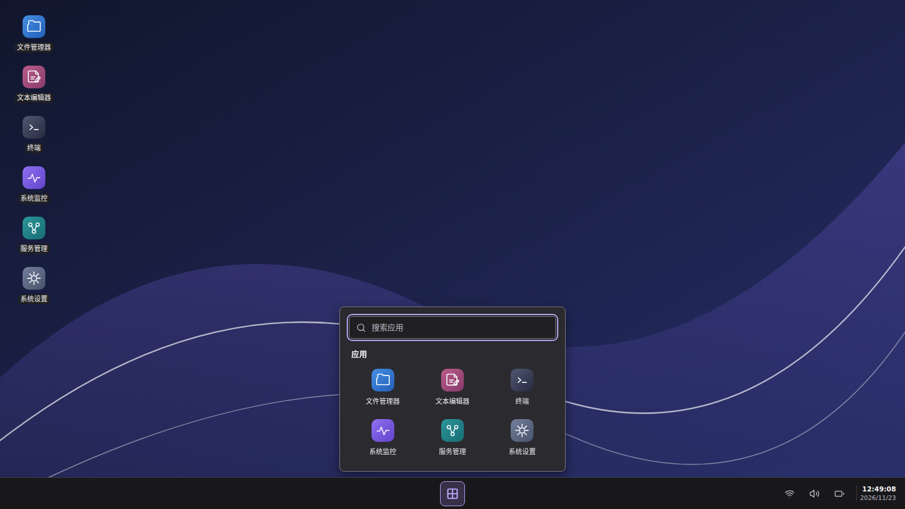
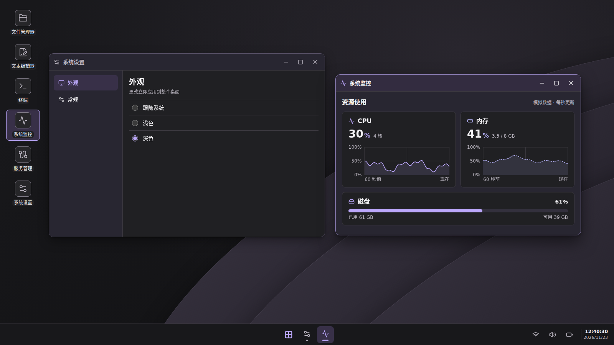

# React Web Desktop

goDesk 的 `frontend/` 基于 React Web Desktop 脚手架，使用 React、TypeScript、Vite、Tailwind CSS 4 和 WMKit。它支持独立开发预览，也可由 goDesk 后端提供静态页面。完整项目的联调和发布步骤见 [goDesk 项目说明](../README.md)。

桌面外壳包含桌面快捷方式、开始菜单、任务栏和右键菜单。应用可以在可拖动、缩放、最小化和最大化的窗口中打开。内置文件管理器、文本编辑器、终端、系统监控、服务管理和系统设置，可作为接入自有应用的参考。

## 界面预览


| 深色桌面的开始菜单 | 深色主题下的多窗口布局 |
| --- | --- |
|  |  |

## 快速开始

在 `frontend/` 目录使用 Node.js 24 和 pnpm 12 运行以下命令。

```sh
pnpm install --frozen-lockfile
pnpm dev
```

在浏览器打开 Vite 输出的本地地址，默认是 `http://localhost:5173`。使用演示密码 **`react-web-desktop`** 登录。

在本地地址后加上 `?window-theme=glass` 可预览 WMKit Glass 窗口外观。

## 基于脚手架开发

1. 在 `src/` 创建应用组件，并参照 `src/apps.ts` 中的 `monitor` 条目注册应用 ID、名称、图标、窗口默认尺寸和 `Content` 组件。桌面快捷方式和开始菜单会自动列出新应用，启动后可在任务栏切换。
2. 在 `src/styles/theme.css` 统一调整颜色、字体和尺寸。新增界面可复用 `--react-web-desktop-*` CSS 变量及其 Tailwind 映射。布局和交互细节见 [UI 设计规范](docs/ui-design/01-design-principles.md) 和 [设计 Token](docs/ui-design/02-design-tokens.md)。
3. 定制品牌时，修改 `package.json` 中的包名、`index.html` 的页面标题、`public/favicon.svg` 的标识，以及登录页和桌面外壳中的显示名称。
4. 接入业务时，在 `src/main.tsx` 替换 `DemoSession` 为应用自己的入口和会话管理。内置登录、文件、终端、监控、服务和托盘使用浏览器内的示例逻辑或数据，可按需保留或接入后端。

## 构建与部署

在 `frontend/` 目录运行以下命令。

```sh
pnpm lint
pnpm build
pnpm preview
```

`pnpm build` 先运行 TypeScript 检查，再生成 `dist/` 静态产物。可将 `dist/` 部署到静态文件服务器。部署到子路径时，先在 `vite.config.ts` 中设置对应的 `base`。

## 体验内置应用

- 登录状态在当前标签页刷新后保留。通过「开始 → 退出登录」结束演示会话并重置桌面、草稿和示例文件。
- 单击桌面快捷方式选中，双击打开。也可以用 Tab 聚焦后按 Enter 打开，或在开始菜单中搜索并启动。
- 拖住窗口标题栏可移动窗口，拖动边缘和四角可改变尺寸。标题栏按钮支持最小化、最大化、还原和关闭。
- 任务栏显示运行中的应用和当前焦点。点击应用可激活窗口或恢复最小化的窗口。
- 在「系统设置 → 外观」切换主题。外观适用于桌面外壳与全部内置应用。
- 在桌面空白处右键，可选择暮紫或灰阶壁纸。取消勾选当前选项可恢复默认鸢尾壁纸。选择「刷新」可以重新加载桌面。

### 文件管理器

- 从「位置」或路径面包屑进入目录，用「返回」「前进」「上一级」切换；返回已访问目录会恢复选择、列表滚动位置与可用焦点。内容区达到 600 px 时固定显示位置导航，达到 960 px 时可同时显示属性。较窄窗口用「位置」「属性」和「更多」访问相同功能。
- 用工具栏的「布局」在列表、平铺、大图标间切换。大图标显示可用的图片缩略图，可到「下载」查看示例。当前浏览器会记住布局和最后一次手动调整的普通窗口宽高。
- 单击选择文件，按 Ctrl（macOS 用 Command）切换多选，按 Shift 连续选择。双击或按 Enter 打开文件夹、编辑文本文件、预览其他文件或查看压缩包。右键文件、文件夹、选区或文件区空白可打开相应菜单，键盘可用 Shift+F10 打开。
- 用「新建文件夹」创建目录，按 F2 原位重命名。Ctrl+X/C/V 在应用内剪切、复制和粘贴。可在「更多」中选择「移动到…」或「复制到…」，也可将条目拖到列表文件夹或侧栏目录。拖动已选中项会移动整组，拖动未选中项只移动该条目，Esc 可取消拖动。
- 同名时可保留两者、替换或跳过；替换会把目标旧项移到回收站。选中「项目」中的 `项目示例.zip` 可查看内容并解压到指定目录。按 Delete 将选中项移到回收站，用「撤销」或 Ctrl+Z 恢复上次文件操作。
- 文件管理器和文本编辑器共享当前网页会话中的文件。关闭文件管理器会清除剪贴板和文件操作撤销记录。刷新网页会重置示例文件。

### 文本编辑器

- 从桌面、开始菜单或文件管理器打开。支持在同一个窗口中编辑多个 `.txt`、`.md`、`.log` 和 `.json` 文件。重开同一个文件会切换到已有标签页。
- 点击「保存」或按 Ctrl+S（macOS 用 Command+S）写回文件。新建文件首次保存时填写名称和选择目录，省略扩展名时自动补 `.txt`。关闭含有修改的标签页或窗口时，可以保存、放弃修改或取消关闭。
- 文件改名或移动后，标签页会跟随文件。原文件不可编辑时可将草稿另存为新文件。回收站中的文件可以从文件管理器预览。

### 终端和系统监控

- 终端使用 xterm.js，打开即可输入 `help` 查看命令。使用 `ls`、`cd` 和 `cat` 浏览同一网页会话中的文件。上下方向键查找历史命令，Ctrl+C 取消输入，Ctrl+L 清屏。
- 系统监控显示 CPU 和内存最近 60 秒的模拟趋势，每秒更新，同时显示磁盘已用和可用容量。

## 技术实现

- React 和 TypeScript 渲染桌面、菜单、任务栏、窗口外观和内置应用。项目使用 Tailwind CSS 4、Lucide React 和少量专用 CSS。
- `src/styles/theme.css` 定义语义颜色和共用尺寸，并通过 Tailwind CSS 4 的 `@theme inline` 暴露。页面首次绘制前解析外观，运行中统一更新根节点的 `data-theme` 和 CSS `color-scheme`。Monaco 与 xterm.js 读取同一套颜色变量。
- `src/App.tsx` 通过 WMKit 0.13.1 的官方 React Adapter 绑定工作区和窗口。WMKit 处理指针交互、窗口生命周期、焦点和层级，任务栏从同一个 WMKit 状态读取窗口和焦点。
- 工作区预留任务栏高度。WMKit 根据工作区调整最大化窗口，限制普通浮动窗口的最小尺寸为 320 × 240 CSS 像素，并保留可抓取的标题栏区域。
- `src/apps.ts` 定义应用快捷方式和窗口初始尺寸。文本编辑器的标签页和文件操作在 `src/TextEditorApp.tsx`，可复用的文本编辑接口在 `src/text-editor/index.tsx`。替换引擎时在该入口选择新的适配器并重新构建。Monaco 适配器和本地 Worker 在首次打开文档时按需载入，同一网页中的 Monaco 实例共享主题。

## 浏览器状态

刷新会重置打开的窗口、桌面壁纸和示例文件。主题、窗口尺寸、文件布局和音量使用浏览器本地存储。项目改名后使用新的存储键，已有的演示会话和浏览器偏好需重新设置。
